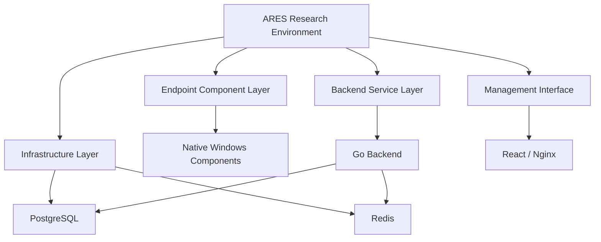

# ARES Framework
### Adversary Research, Emulation & Security Engineering

<p align="center">
  <strong>A Multi-Component Red Team Research Framework with a Blue Team Detection Perspective</strong>
</p>

<p align="center">
  
  
  
  
</p>

---

## 1. Project Overview

**ARES (Adversary Research & Emulation System)** is an individual cybersecurity research project focused on exploring adversary behavior, modular security architecture, Windows internals, and multi-component security engineering.

The project investigates how different components of an adversary-emulation environment can be organized, integrated, and managed through a centralized architecture.

Unlike a standalone security script, ARES is structured as a multi-language, multi-component framework consisting of native Windows components, a backend service, a management interface, supporting tools, and infrastructure services.

### Primary Research Objectives

- Explore Windows Native Programming and low-level system interactions.
- Study modular software architecture for security research.
- Understand agent-based architecture and centralized management.
- Investigate backend communication and infrastructure integration.
- Examine adversary behaviors from a defensive security perspective.
- Identify potential endpoint telemetry and detection opportunities.
- Develop practical engineering skills across multiple programming languages.

**Project positioning:** ARES is a controlled-lab research project, not a production security product or an independently validated penetration-testing solution.

## 2. Key Engineering Highlights

| Area | Implementation / Research |
|---|---|
| System Programming | C, Windows Native Development |
| Backend Engineering | Go |
| Automation & Tooling | Python |
| Frontend Engineering | React, Nginx |
| Database | PostgreSQL |
| Caching | Redis |
| Infrastructure | Docker Compose |
| Build System | GNU Make, GCC |
| Security Research | Windows Internals, PE analysis, adversary behavior |
| Defensive Perspective | Endpoint telemetry and detection research |

### Engineering Highlights

- Multi-language architecture integrating C, Go, Python, and JavaScript.
- Modular native-code organization.
- Separate backend and frontend components.
- Container-based infrastructure definition.
- Build configurations and supporting test utilities.
- Research-oriented agent role specifications.

These are repository-level implementation characteristics; runtime performance and production readiness have not yet been independently established.

## 3. System Architecture

ARES is organized into several major architectural layers.

### 3.1. Architecture Overview



*Conceptual architecture based on repository structure and service declarations.*

### 3.2. Endpoint Component Layer

**Technology:** C / Windows Native Programming

Research areas:

- Windows native application development.
- Modular source-code organization.
- PE (Portable Executable) format analysis.
- Windows process and system behavior.
- Endpoint security telemetry considerations.

### 3.3. Backend Service Layer

**Technology:** Go

The repository contains a dedicated C2 server component.

Engineering areas:

- Backend service organization.
- API-oriented architecture.
- Communication management.
- Data persistence integration.
- Separation of service responsibilities.

### 3.4. Management Interface

**Technology:** React / Nginx

A separate frontend component is included to represent the management interface.

Research areas:

- Frontend/backend separation.
- Web application architecture.
- Service integration.
- Infrastructure-based deployment configuration.

### 3.5. Infrastructure Layer

**Technology:** Docker Compose / PostgreSQL / Redis

Infrastructure definitions include:

- PostgreSQL for persistent data storage.
- Redis for caching and supporting backend services.
- Docker-based service orchestration.
- Internal service networking.
- Configuration and secret management declarations.

Note: The repository also declares an external tunneling component. The complete environment must be reviewed and isolated before any lab deployment.

## 4. Multi-Agent Architecture Research

ARES includes a role-based agent architecture specification.

The design separates research responsibilities into five specialized roles.

| Agent | Research Domain |
|---|---|
| VANGUARD | Reconnaissance and OSINT |
| STRIKER | Initial-access behavior |
| SHADOW | Stealth and persistence behavior |
| NOMAD | Lateral-movement behavior |
| HERMES | Data movement and exfiltration behavior |

### Research Goals

- Study separation of responsibilities.
- Explore modular agent coordination.
- Understand how different adversary stages relate to one another.
- Establish a foundation for mapping adversary behavior to defensive detection opportunities.

The five roles are documented in the repository. Their independent execution and orchestration capabilities require further implementation verification.

## 5. Windows Internals & Security Engineering

One of the main technical research areas in ARES is Windows Native Programming.

The source tree and build configuration demonstrate work involving:

- Native C development.
- Windows-specific components.
- PE binary structure and metadata.
- Modular compilation.
- Debug and release configurations.
- Python-based supporting utilities.

### Why This Matters

Understanding operating-system internals helps security engineers interpret endpoint behavior beyond high-level application logs.

For Blue Team operations, this knowledge can support:

- Investigating unusual process behavior.
- Understanding suspicious executable characteristics.
- Analyzing endpoint telemetry.
- Recognizing potentially abnormal system interactions.
- Improving the technical context of security alerts.

## 6. Blue Team & SOC Research Perspective

Although ARES is structured around adversary research, an important learning objective is understanding how defenders can investigate the behaviors being studied.

The following table describes research opportunities, not detection capabilities already validated in ARES.

| Research Area | Potential Defensive Investigation |
|---|---|
| Process behavior | Unusual process creation and parent-child relationships |
| Persistence | Unexpected registry or scheduled-task modifications |
| Network communication | Unusual outbound connections and communication patterns |
| Binary analysis | Suspicious PE metadata and executable characteristics |
| Credential access | Abnormal access to sensitive authentication-related resources |
| Lateral movement | Unusual authentication and remote access patterns |
| Data movement | Unexpected outbound data transfer |

### Potential SOC Integration Roadmap

- Windows Event Logs and Sysmon telemetry.
- Centralized log collection.
- SIEM-based event correlation.
- MITRE ATT&CK technique mapping.
- Detection engineering.
- Alert investigation and incident reporting.

**Important:** SIEM integration, detection rules, and measured detection performance are not claimed as completed features in this repository.

## 7. Development & Engineering Practices

The project includes a collection of supporting development and testing files.

| Component | Purpose |
|---|---|
| Makefile | Build configuration and target organization |
| Python utilities | Supporting automation and analysis |
| Native C source | Windows-oriented system components |
| Go source | Backend service implementation |
| Docker Compose | Infrastructure configuration |
| Test files | Supporting test and validation utilities |

The repository includes multiple test-related source files. Their presence does not establish that all tests pass.

## 8. Technical Achievements

The following achievements are supported by the repository structure and source declarations.

### Achievement 01 — Multi-Language System Engineering

Designed a project structure combining native C, Go, Python, and React-based components.

**Technical value:** Experience working across different programming paradigms and system layers.

### Achievement 02 — Modular Architecture Design

Organized the project into separate endpoint, backend, relay, delivery, tooling, and management components.

**Technical value:** Understanding component separation and software maintainability.

### Achievement 03 — Native Windows Development

Worked with Windows-oriented native C components and PE-related development utilities.

**Technical value:** Exposure to low-level Windows programming and executable analysis.

### Achievement 04 — Backend & Infrastructure Integration

Included a Go backend alongside PostgreSQL, Redis, React, and Docker Compose infrastructure definitions.

**Technical value:** Understanding how backend services and infrastructure components fit into a larger system.

### Achievement 05 — Build Automation

Developed a Makefile-based build organization with different development and release configurations.

**Technical value:** Build management, compiler configuration, and multi-component development workflows.

### Achievement 06 — Security Research Through a Defensive Lens

Established a research direction connecting adversary behavior with endpoint monitoring, event investigation, and detection engineering.

**Technical value:** Developing the mindset required to understand both attack behavior and defensive investigation.

## 9. Testing & Validation

The repository contains test-related source files and validation utilities.

A complete testing report is still required before claiming measurable performance or reliability.

Future validation metrics:

| Metric | Validation Objective |
|---|---|
| Component test coverage | Verify individual components |
| Integration test results | Validate component interaction |
| Service availability | Evaluate service stability |
| Resource consumption | Measure CPU and memory usage |
| Telemetry visibility | Evaluate observable endpoint events |
| Detection coverage | Evaluate defensive visibility of selected behaviors |

No numerical performance or detection results are claimed without reproducible test evidence.

## 10. Security, Ethics & Lab Restrictions

ARES is intended for authorized cybersecurity research and isolated laboratory study.

Because the repository contains components capable of sensitive endpoint and remote-access behavior, it must not be treated as a safe general-purpose deployment package.

Research boundaries:

- Use only systems owned by the researcher or explicitly authorized for testing.
- Do not target third-party infrastructure.
- Do not collect real users' credentials or private information.
- Do not expose control services or sensitive components to public networks.
- Keep experimental systems isolated.
- Review external connectivity and secret handling before running infrastructure.
- Do not distribute generated binaries or potentially harmful components.

This repository is a research artifact, not a recommendation to deploy offensive capabilities in production.

## 11. Current Limitations & Future Improvements

### Current Limitations

- The project requires further end-to-end integration validation.
- Agent role documentation does not yet prove autonomous multi-agent execution.
- Defensive telemetry collection and SIEM integration are not established as completed modules.
- No reproducible detection-performance benchmark is currently documented.
- Lab isolation and security configuration require further verification.

### Future Development Roadmap

**Phase 1 — Architecture & Reliability**
- Improve component documentation.
- Review service dependencies.
- Improve configuration management.
- Add reproducible integration tests.

**Phase 2 — Defensive Telemetry**
- Build a dedicated endpoint telemetry collection component.
- Develop Windows event analysis workflows.
- Map observable behavior to MITRE ATT&CK.

**Phase 3 — SOC Integration**
- Integrate with a controlled SIEM environment.
- Develop detection use cases.
- Evaluate false positives and false negatives.
- Document investigation procedures.

**Phase 4 — Security Evaluation**
- Conduct repeatable laboratory experiments.
- Produce technical test reports.
- Measure system performance.
- Document defensive coverage and limitations.

## 12. Repository Structure

```text
ares-redteam-swarm/
│
├── agent/          # Endpoint component source
├── c2-relay/       # Relay-related components
├── c2server/       # Backend service
├── delivery/       # Delivery-related components
├── infra/          # Infrastructure configuration
├── panel/          # Management interface
├── skills/         # Agent skill specifications
├── tool/           # Supporting tools
├── tools/          # Development utilities
│
├── Makefile
├── ares_builder.py
├── docker-compose.yml
├── AGENTS.md
├── BOOTSTRAP.md
└── test_*.py / test_*.c
```

This is a high-level repository map. Refer to individual source directories for their actual implementation details.

## 13. Author & Project Information

**Developer:** Đặng Lê Anh Tú

**Role:** Individual Developer / Cybersecurity Researcher

**Project:** ARES Framework

**Focus Areas:**
- Cybersecurity Research
- Windows Internals
- Security Engineering
- Red Team Adversary Research
- Blue Team / SOC Detection

**GitHub:** https://github.com/anhtu143/ares-redteam-swarm

---

<p align="center">
  <strong>Understand the adversary. Analyze the behavior. Strengthen the defense.</strong>
</p>

*ARES is an independently developed academic and laboratory research project. All research activities are restricted to authorized environments.*
